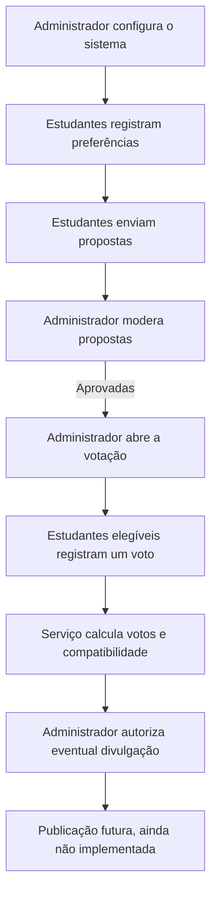

# ThreeShirt

ThreeShirt é um projeto escolar em desenvolvimento para organizar a escolha
da camiseta do terceirão. O backend reúne preferências dos estudantes,
propostas de design, moderação e regras de votação e apuração em um fluxo
persistido e verificável.

O projeto busca tornar a decisão coletiva mais estruturada: estudantes podem
registrar preferências e propostas, enquanto administradores controlam a
moderação e a votação. A compatibilidade entre preferências e propostas
complementa a apuração dos votos, sem substituir a escolha democrática.

> **Estado atual:** regras de negócio do backend implementadas e cobertas por
> testes automatizados. O projeto não possui frontend de estudante nem API
> para consultar ou publicar resultados; ainda não é um serviço de produção.

## Conteúdo

- [Funcionalidades e escopo](#funcionalidades-e-escopo)
- [Fluxo do sistema](#fluxo-do-sistema)
- [Regras e decisões técnicas](#regras-e-decisões-técnicas)
- [Arquitetura](#arquitetura)
- [Tecnologias](#tecnologias)
- [Executar localmente no Windows](#executar-localmente-no-windows)
- [Testes e validação](#testes-e-validação)
- [Estrutura do repositório](#estrutura-do-repositório)
- [Processo de desenvolvimento](#processo-de-desenvolvimento)
- [Próximas etapas e limites](#próximas-etapas-e-limites)

## Funcionalidades e escopo

| Área | Estado |
| --- | --- |
| Login por código temporário enviado ao e-mail | Implementado no backend |
| Pesquisa de preferências individual | Implementada no serviço de negócio |
| Cadastro de propostas por estudantes | Implementado no serviço de negócio |
| Moderação de propostas no Django Admin | Implementada |
| Armazenamento e entrega protegida de imagens | Implementados |
| Abertura e encerramento manual da votação | Implementados no Django Admin |
| Voto único em proposta aprovada | Implementado no serviço de negócio |
| Apuração de votos, percentuais e empates | Implementada no serviço de negócio |
| Média de compatibilidade com a pesquisa | Implementada no serviço de negócio |
| Autorização persistente para divulgação futura | Implementada; inicia desativada |
| Interface de estudante e publicação/consulta de resultados | Não implementadas |

As funcionalidades de pesquisa, submissão e votação estão disponíveis como
serviços internos do backend, não como uma API pública de estudante. As rotas
HTTP existentes cobrem solicitação/verificação do código de login e entrega
protegida das imagens de propostas.

## Fluxo do sistema



## Regras e decisões técnicas

### Votação e apuração

- Cada estudante pode registrar no máximo um voto. `Vote.student` é uma
  relação `OneToOneField`, impondo unicidade também no banco.
- O serviço de voto exige usuário autenticado, ativo, com perfil de estudante,
  votação aberta e proposta aprovada.
- A apuração conta votos reais do banco e considera no ranking e no
  denominador somente votos associados a propostas atualmente aprovadas.
- Se uma proposta que recebeu votos deixar de estar aprovada, seus votos não
  são apagados: são reportados separadamente como excluídos da apuração
  corrente. Essa escolha conserva o histórico sem incluir proposta inelegível
  entre as vencedoras.
- Sem votos válidos, o resultado informa ausência de votos, não calcula
  percentuais e não declara vencedora. Empates de votos retornam todas as
  propostas com a maior contagem.

### Compatibilidade

- `calculate_compatibility()` compara cada resposta individual com cada
  proposta aprovada e retorna o escore e a quantidade de critérios
  comparáveis.
- A média geral considera respostas de contas atualmente ativas com perfil
  `STUDENT`; perfis administrativos, ausentes ou inativos não participam.
- A média geral é calculada somente sobre escores individuais válidos. Uma
  resposta insuficiente não é tratada como zero; sem avaliações válidas, o
  resultado informa dados insuficientes.
- Empates de compatibilidade são definidos após arredondamento para duas
  casas decimais com `ROUND_HALF_UP`, a mesma precisão de apresentação usada
  pelo cálculo individual. Todas as propostas equivalentes nessa precisão
  são retornadas.

### Autorização de divulgação

`ElectionSettings.results_release_authorized` persiste a decisão
administrativa, começa desativado e é controlado pelas permissões do Django
Admin já existentes. Calcular resultados não habilita divulgação. Não há,
nesta etapa, endpoint, tela ou mecanismo que efetivamente publique ou
restrinja a consulta dos resultados.

### Imagens, permissões e integridade

- Imagens de propostas são verificadas pelo conteúdo com Pillow, limitadas a
  5 MiB e aceitas nos formatos PNG, JPEG e WebP.
- Os arquivos ficam em armazenamento privado sem URL pública. A rota
  protegida permite a imagem de proposta pendente apenas ao administrador
  autorizado; imagens aprovadas podem ser vistas por estudantes autenticados
  e administradores autorizados. Propostas rejeitadas não são servidas.
- A migration `0004` migra imagens previamente armazenadas no diretório
  público para o armazenamento privado. Sua reversão é deliberadamente
  limitada para evitar recolocar imagens no armazenamento público.
- No SQLite, `transaction_mode="IMMEDIATE"` inicia transações com bloqueio de
  escrita antecipado. Operações de voto e de alteração da configuração têm
  repetição limitada para erros SQLite de contenção; a constraint de
  unicidade continua sendo a proteção final contra votos duplicados.
- A configuração atual é de desenvolvimento (`DEBUG=True`); use segredo,
  e-mail, hospedagem e configurações de segurança apropriados antes de
  qualquer implantação real.

## Arquitetura

- **`accounts`**: perfis e papéis de usuário, login por código temporário e
  site administrativo restrito a e-mails autorizados.
- **`election`**: preferências, propostas, votos e configuração singleton da
  eleição; serviços concentram validações, compatibilidade e apuração.
- **Django Admin**: interface administrativa existente para moderar propostas,
  controlar pesquisa/votação e autorizar a divulgação futura.
- **Armazenamento privado**: `PrivateProposalStorage` mantém imagens fora de
  URLs públicas; a view protegida valida e entrega somente arquivos
  permitidos.
- **Testes**: `accounts/tests.py` e `election/tests.py` verificam regras de
  negócio, permissões, migrações de imagem e concorrência SQLite com conexões
  independentes.

## Tecnologias

Dependências listadas em `threeshirt/requirements.txt`:

| Tecnologia | Versão |
| --- | --- |
| Django | 6.1.2 |
| Pillow | 12.3.0 |
| python-dotenv | 1.2.4 |

Os testes desta revisão foram executados com Python 3.14.3 e SQLite 3.50.4.
Essas versões descrevem o ambiente local, não uma matriz de compatibilidade
para outros ambientes.

## Executar localmente no Windows

Abra o PowerShell na raiz do repositório:

```powershell
Set-Location .\threeshirt
py -3.14 -m venv .venv
.\.venv\Scripts\Activate.ps1
python -m pip install -r .\requirements.txt
```

Crie `threeshirt\.env` localmente. Não compartilhe nem versione esse arquivo:

```dotenv
DJANGO_SECRET_KEY=use-uma-chave-aleatoria-local
THREESHIRT_ALLOWED_EMAILS=admin@exemplo.com
THREESHIRT_ADMIN_EMAILS=admin@exemplo.com
```

Cadastre a conta administrativa inicial com um e-mail incluído nas duas
variáveis:

```powershell
python -c "from django.core.management.utils import get_random_secret_key; print(get_random_secret_key())"
python manage.py migrate
python manage.py createsuperuser
python manage.py runserver
```

Use o valor gerado para `DJANGO_SECRET_KEY`. A aplicação só autentica e-mails
autorizados que correspondam a usuários já cadastrados. No ambiente local, o
backend padrão de e-mail é o console: o código temporário é exibido na saída
do servidor. O painel administrativo fica em `http://127.0.0.1:8000/admin/`;
as rotas de autenticação são `POST /api/accounts/request-code/` e
`POST /api/accounts/verify-code/`.

> O comando `migrate` aplica as migrations pendentes no banco configurado.
> Antes de usá-lo em um banco com dados importantes, confira o plano e faça
> um backup validado.

## Testes e validação

Com o ambiente virtual ativado, na pasta `threeshirt`:

```powershell
python manage.py check
python manage.py makemigrations --check --dry-run
python manage.py test election accounts
```

Na revisão local de encerramento das Etapas 5 a 8:

- `manage.py check`: sem problemas identificados.
- `manage.py makemigrations --check --dry-run`: nenhuma migration adicional
  detectada.
- `manage.py test election accounts`: **130 testes aprovados**.
- `git diff --check`: sem erros de whitespace.

Esses resultados são de uma execução local específica, não de CI ou de um
ambiente de produção.

## Estrutura do repositório

```text
ThreeShirt/
├── README.md
└── threeshirt/
    ├── manage.py
    ├── requirements.txt
    ├── backend/
    │   ├── settings.py
    │   └── urls.py
    ├── accounts/
    │   ├── models.py
    │   ├── views.py
    │   ├── admin.py
    │   └── tests.py
    └── election/
        ├── models.py
        ├── services.py
        ├── concurrency.py
        ├── views.py
        ├── storage.py
        ├── validators.py
        ├── admin.py
        ├── tests.py
        └── migrations/
```

O banco SQLite e os diretórios de arquivos enviados são dados locais; não
devem ser tratados como parte do código-fonte.

## Processo de desenvolvimento

As etapas implementadas foram construídas progressivamente em torno dos
modelos e serviços Django existentes:

1. Autenticação e perfis estabelecem os papéis de estudante e administrador.
2. A pesquisa persiste preferências e fornece os dados para o cálculo
   individual de compatibilidade.
3. Propostas passam por validação e moderação administrativa; as imagens são
   armazenadas em área privada e servidas por uma rota protegida.
4. A votação controla abertura e encerramento, valida elegibilidade e impõe
   voto único também no banco. No SQLite, transações `IMMEDIATE` e repetição
   limitada lidam com contenção concorrente.
5. A apuração agrega votos, mantém visíveis os votos excluídos por status e
   calcula médias individuais sem converter dados insuficientes em zero.
6. A autorização administrativa de divulgação é persistente e separada do
   cálculo; publicação e apresentação continuam planejadas.

As decisões são cobertas por testes automatizados das aplicações `election`
e `accounts`. A migration `0005` adiciona a autorização com valor inicial
desativado; migrations locais devem ser verificadas antes de aplicação.

## Próximas etapas e limites

- **Planejada:** Fase 2 — Planejamento Visual e Frontend.
- **Ainda não implementado:** interface de estudante para pesquisa,
  propostas e votação; API para consumo dos resultados; publicação efetiva
  dos resultados.
- **Ainda não confirmado:** equipe, responsabilidades individuais,
  implantação e operação em produção. Por isso, este README não atribui
  créditos pessoais nem declara o sistema pronto para uso real.
