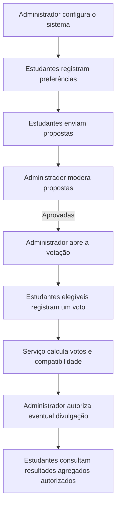

# ThreeShirt

ThreeShirt é um projeto escolar em desenvolvimento para organizar a escolha
da camiseta do terceirão. O backend reúne preferências dos estudantes,
propostas de design, moderação e regras de votação e apuração em um fluxo
persistido e verificável.

O projeto busca tornar a decisão coletiva mais estruturada: estudantes podem
registrar preferências e propostas, enquanto administradores controlam a
moderação e a votação. A compatibilidade entre preferências e propostas
complementa a apuração dos votos, sem substituir a escolha democrática.

> **Estado atual:** a jornada do estudante está integrada ao backend: login
> por Gmail e senha, primeiro acesso e alteração de senha próprios,
> pesquisa, propostas, voto e consulta de resultados autorizados.
> O projeto permanece em desenvolvimento e não é um serviço de produção.

## Conteúdo

- [Funcionalidades e escopo](#funcionalidades-e-escopo)
- [Fluxo do sistema](#fluxo-do-sistema)
- [Regras e decisões técnicas](#regras-e-decisões-técnicas)
- [Arquitetura](#arquitetura)
- [Tecnologias](#tecnologias)
- [Executar localmente no Windows](#executar-localmente-no-windows)
- [Frontend (Etapa 12)](#frontend-etapa-12)
- [Testes e validação](#testes-e-validação)
- [Estrutura do repositório](#estrutura-do-repositório)
- [Processo de desenvolvimento](#processo-de-desenvolvimento)
- [Próximas etapas e limites](#próximas-etapas-e-limites)

## Funcionalidades e escopo

| Área | Estado |
| --- | --- |
| Login por senha, sessão e logout | Contas previamente cadastradas autenticam por Gmail autorizado e senha com hash Django |
| Primeiro acesso e alteração de senha | Primeiro acesso de conta ativa existente sem senha; cada usuário altera somente a própria senha |
| Bloqueio, reativação e reinicialização de contas | Ações justificadas e auditadas; reinicialização básica preserva histórico eleitoral |
| Invalidação e autorização de voto substituto | Registro preservado, auditoria obrigatória e limite de um voto válido |
| Snapshots de resultados | Versões publicadas preservadas quando invalidações alteram a apuração |
| Pesquisa individual de preferências | Consulta e gravação próprias disponíveis por API e formulário React; gravação depende da pesquisa aberta |
| Cadastro e acompanhamento de propostas | Envio por API e formulário; estudante acompanha somente propostas próprias |
| Moderação de propostas no Django Admin | Implementada |
| Armazenamento e entrega protegida de imagens | Implementados; a galeria lista somente propostas aprovadas |
| Abertura e encerramento manual da votação | Implementados no Django Admin |
| Voto único em proposta aprovada | Implementado no backend, com unicidade no banco e confirmação na interface |
| Apuração de votos, percentuais e empates | API e tela agregadas, liberadas após autorização e encerramento da votação |
| Média de compatibilidade com a pesquisa | API e tela agregadas; respostas individuais não são expostas |
| Autorização persistente para divulgação | Controlada pelo administrador; começa desativada |

O estudante pode editar suas próprias preferências enquanto a pesquisa estiver
aberta. Propostas enviadas seguem pendentes até moderação administrativa; não
há edição de propostas pelo estudante. Um voto só é aceito uma vez, durante a
votação aberta, para uma proposta aprovada. Os resultados só são retornados
depois do encerramento e da autorização administrativa.

## Fluxo do sistema



## Regras e decisões técnicas

### Autenticação e acesso

O login convencional exige uma conta previamente provisionada, incluída em
`THREESHIRT_ALLOWED_EMAILS` e com senha. Não há cadastro público nem criação de
contas pelo painel administrativo. Em **Primeiro acesso? Defina sua senha**, o
titular informa o e-mail e define e confirma uma senha se a conta já existir,
estiver ativa, autorizada e ainda não possuir senha. Contas ADMIN também
precisam estar em `THREESHIRT_ADMIN_EMAILS`. O fluxo não cria conta nem altera papel,
status ou permissões e não exige aprovação. Se a conta já tiver senha, ela não
é alterada e a pessoa deve entrar pelo login normal.

O Django armazena senhas somente com seu mecanismo de hash. O login usa e-mail
e senha, mensagens genéricas para credenciais inválidas e limitação persistida
de tentativas por conta e origem. Uma pessoa autenticada altera apenas a senha
da própria conta, informando a senha atual e confirmando a nova senha. Não há
fluxo de recuperação de senha pelo site, aprovação administrativa, códigos de
login ou envio de e-mail. Os registros históricos de solicitações anteriores
são preservados, mas não podem mais ser criados ou decididos pelo sistema.

Para uma emergência envolvendo uma conta ADMIN, um operador com acesso local
ao backend pode executar `python manage.py recover_admin_password`. O comando
aceita somente uma conta Gmail existente, ativa e com papel ADMIN na lista
`THREESHIRT_ADMIN_EMAILS`, exige confirmação explícita, justificativa e senha
digitada sem eco no terminal. Ele não cria contas nem altera o papel, revoga
sessões anteriores e registra a operação como recuperação local sem
administrador autenticado.

Sessões carregam a revisão das credenciais da conta; bloqueios, reativações,
trocas de papel, trocas de senha e reinicializações incrementam essa revisão e
invalidam sessões antigas, inclusive as persistidas em uma corrida com a
revogação.

As alterações de senha, bloqueios, reativações, papéis e reinicializações
registram ator, alvo, data e justificativa. A reinicialização comum preserva
respostas, propostas e votos em uma geração histórica separada. A invalidação
eleitoral também é lógica e auditada; resultados oficiais excluem registros
invalidados e snapshots preservam as versões anteriormente publicadas.

### Votação e apuração

- Cada geração de participação pode ter no máximo um voto válido. Uma
  constraint parcial no banco permite manter votos invalidados e, após
  autorização administrativa auditada, registrar um novo voto.
- O serviço de voto exige usuário autenticado, ativo, com perfil de estudante,
  votação aberta e proposta aprovada.
- A apuração conta somente participações elegíveis e não invalidadas;
  snapshots encadeados preservam os resultados anteriormente publicados.
- Se uma proposta que recebeu votos deixar de estar aprovada, seus votos não
  são apagados: são reportados separadamente como excluídos da apuração
  corrente. Essa escolha conserva o histórico sem incluir proposta inelegível
  entre as vencedoras.
- Sem votos válidos, o resultado informa ausência de votos, não calcula
  percentuais e não declara vencedora. Empates de votos retornam todas as
  propostas com a maior contagem.

### Compatibilidade

- `calculate_compatibility()` compara cada resposta individual com cada
  proposta aprovada e retorna o escore e a quantidade de critérios
  comparáveis.
- A média geral considera respostas de contas atualmente ativas com perfil
  `STUDENT`; perfis administrativos, ausentes ou inativos não participam.
- A média geral é calculada somente sobre escores individuais válidos. Uma
  resposta insuficiente não é tratada como zero; sem avaliações válidas, o
  resultado informa dados insuficientes.
- Empates de compatibilidade são definidos após arredondamento para duas
  casas decimais com `ROUND_HALF_UP`, a mesma precisão de apresentação usada
  pelo cálculo individual. Todas as propostas equivalentes nessa precisão
  são retornadas.

### Autorização de divulgação

`ElectionSettings.results_release_authorized` persiste a decisão
administrativa, começa desativado e é controlado pelas permissões do Django
Admin já existentes. Calcular resultados não habilita divulgação. A API exige
estudante ativo, autorização administrativa e votação encerrada; sem essas
condições, os dados agregados não são retornados.

### Imagens, permissões e integridade

- Imagens de propostas são verificadas pelo conteúdo com Pillow, limitadas a
  5 MiB e aceitas nos formatos PNG, JPEG e WebP.
- Os arquivos ficam em armazenamento privado sem URL pública. A rota
  protegida permite a imagem de proposta pendente apenas ao administrador
  autorizado; imagens aprovadas podem ser vistas por estudantes autenticados
  e administradores autorizados. Propostas rejeitadas não são servidas.
- A migration `0004` migra imagens previamente armazenadas no diretório
  público para o armazenamento privado. Sua reversão é deliberadamente
  limitada para evitar recolocar imagens no armazenamento público.
- No SQLite, `transaction_mode="IMMEDIATE"` inicia transações com bloqueio de
  escrita antecipado. Operações de voto e de alteração da configuração têm
  repetição limitada para erros SQLite de contenção; a constraint de
  unicidade continua sendo a proteção final contra votos duplicados.
- A configuração atual é de desenvolvimento (`DEBUG=True`); use segredo,
  e-mail, hospedagem e configurações de segurança apropriados antes de
  qualquer implantação real.

## Arquitetura

- **`accounts`**: perfis e papéis, autenticação por senha, primeiro acesso
  próprio, limitação de tentativas e auditoria de contas.
- **`election`**: preferências, propostas, votos e configuração singleton da
  eleição; serviços concentram validações, compatibilidade e apuração.
- **Django Admin**: interface administrativa existente para moderar propostas,
  controlar pesquisa/votação e autorizar a divulgação futura.
- **Armazenamento privado**: `PrivateProposalStorage` mantém imagens fora de
  URLs públicas; a view protegida valida e entrega somente arquivos
  permitidos.
- **Frontend**: `frontend/` contém a interface React, TypeScript e Vite, com
  login por senha, primeiro acesso e telas de preferências, propostas,
  galeria/votação e resultados. O proxy de desenvolvimento encaminha `/api`
  e `/proposals` ao Django sem alterar os caminhos.
- **Testes**: `accounts/tests.py` e `election/tests.py` verificam regras de
  negócio, permissões, migrações de imagem e concorrência SQLite com conexões
  independentes.

## Tecnologias

Dependências listadas em `threeshirt/requirements.txt`:

| Tecnologia | Versão |
| --- | --- |
| Django | 6.1.2 |
| Pillow | 12.3.0 |
| python-dotenv | 1.2.4 |

Os testes desta revisão foram executados com Python 3.14.3 e SQLite 3.50.4.
Essas versões descrevem o ambiente local, não uma matriz de compatibilidade
para outros ambientes.

O frontend usa React, TypeScript e Vite. As versões e dependências exatas
ficam declaradas em `frontend/package.json` e travadas em
`frontend/package-lock.json`; é necessário Node.js 20.19+ (ou 22.12+).

## Executar localmente no Windows

Abra o PowerShell na raiz do repositório:

```powershell
Set-Location .\threeshirt
py -3.14 -m venv .venv
.\.venv\Scripts\Activate.ps1
python -m pip install -r .\requirements.txt
```

Crie `threeshirt\.env` localmente. Não compartilhe nem versione esse arquivo:

```dotenv
DJANGO_SECRET_KEY=use-uma-chave-aleatoria-local
THREESHIRT_ALLOWED_EMAILS=admin@exemplo.com
THREESHIRT_ADMIN_EMAILS=admin@exemplo.com
THREESHIRT_CSRF_TRUSTED_ORIGINS=http://127.0.0.1:5173,http://localhost:5173,http://192.168.0.95:5173
```

Cadastre previamente cada usuário pela administração e inclua o Gmail nas
listas adequadas. O primeiro acesso define uma senha apenas para contas já
cadastradas, ativas e sem senha:

```powershell
python -c "from django.core.management.utils import get_random_secret_key; print(get_random_secret_key())"
python manage.py migrate
python manage.py runserver
```

Use o valor gerado para `DJANGO_SECRET_KEY`. O login aceita somente Gmail
autorizado. Estudantes devem estar em `THREESHIRT_ALLOWED_EMAILS`;
administradores que usarão o acesso inicial devem estar em
`THREESHIRT_ADMIN_EMAILS` (e também na lista de login se usarem o login
convencional).
Configure a lista separada por vírgulas em
`THREESHIRT_ALLOWED_EMAILS`; inclua administradores também em
`THREESHIRT_ADMIN_EMAILS`. Não há dependência de SMTP, Brevo ou provedor de
e-mail para autenticação. O painel administrativo fica em
`http://127.0.0.1:8000/admin/`. As rotas principais são
`POST /api/accounts/login/`, `POST /api/accounts/first-access/` e
`POST /api/accounts/password/change/`.
O frontend obtém um token CSRF por
`GET /api/accounts/csrf/`; a origem informada em
`THREESHIRT_CSRF_TRUSTED_ORIGINS` deve corresponder exatamente à origem do
navegador.

O primeiro acesso não inicia uma sessão: depois de definir a senha, entre pelo
formulário normal. A resposta de login não distingue conta inexistente, não
autorizada, bloqueada ou senha incorreta. Configure
`DJANGO_DEBUG=False` em produção para habilitar cookies `Secure`, além de
configurar um `DJANGO_SECRET_KEY` forte e origens CSRF restritas.

### Frontend (Etapa 12)

Instale e execute o frontend em um segundo terminal, na raiz do repositório:

```powershell
npm --prefix .\frontend ci
npm --prefix .\frontend run dev
```

Abra `http://127.0.0.1:5173/` ou `http://localhost:5173/` no computador.
Para acessar pela rede Wi-Fi, abra `http://192.168.0.95:5173/` no tablet.
O servidor de desenvolvimento escuta conexões da rede local e encaminha, sem
reescrever, `/api/*` e `/proposals/*` ao Django em
`http://127.0.0.1:8000`. Execute o backend separadamente, na pasta
`threeshirt`, com `python manage.py runserver 127.0.0.1:8000`; ele permanece
acessível somente pelo computador, pois o proxy do Vite encaminha as chamadas.
Se a porta `5173` já estiver ocupada, encerre o servidor anterior antes de
iniciar o Vite; ele não mudará de porta para evitar uma origem fora da lista
CSRF autorizada.

Verifique o frontend com:

```powershell
npm --prefix .\frontend run typecheck
npm --prefix .\frontend test
npm --prefix .\frontend run build
```

O login e o primeiro acesso usam as views Django e não enviam e-mail.
Antes de cada POST, o cliente busca um token CSRF em
`/api/accounts/csrf/`, envia-o no cabeçalho `X-CSRFToken` e inclui cookies de
sessão. O proxy de desenvolvimento não contorna o `CsrfViewMiddleware`.
Configure `THREESHIRT_CSRF_TRUSTED_ORIGINS` com as origens exatas necessárias
em cada ambiente. Em desenvolvimento local, permita as três origens mostradas
no exemplo; em produção, não inclua as origens do Vite.
O frontend só informa sucesso após a criação da sessão ser confirmada por
`GET /api/accounts/session/` consulta a sessão atual: retorna HTTP 200
com `{"authenticated": false}` para visitantes; para usuários autenticados,
retorna `authenticated: true` e `user` com `id`, `email` e papel (`student` ou
`admin`) lido do perfil armazenado no backend. A consulta não altera a sessão
nem o perfil.

O endpoint `GET /api/election/student/dashboard/` fornece aos estudantes
ativos somente os estados da pesquisa, votação e divulgação de resultados,
além de indicar se o próprio estudante respondeu às preferências ou votou.
Ele não retorna respostas, votos ou resultados. `GET
/api/election/student/proposals/` lista para estudantes ativos somente as
propostas aprovadas, em ordem da mais recente para a mais antiga, com
desempate determinístico por identificador. A resposta contém os campos
visuais da proposta e aponta para a rota de imagem protegida, sem revelar
dados do autor ou caminho interno do arquivo.

`GET /api/election/student/preferences/` consulta somente as preferências do
estudante autenticado. `POST` no mesmo caminho cria ou atualiza a resposta
enquanto a pesquisa estiver aberta. `GET /api/election/student/submissions/`
retorna os estados e descrições das propostas do próprio estudante; `POST`
no mesmo caminho recebe os campos e a imagem multipart, sempre criando uma
proposta pendente. O estudante não pode editar propostas já enviadas.

`POST /api/election/student/vote/` recebe `{"proposal_id": <id>}` e delega ao
serviço de votação, que valida estudante ativo, votação aberta, proposta
aprovada e voto único. `GET /api/election/student/results/` fornece somente
contagens, percentuais, compatibilidade média e vencedoras; retorna HTTP 403
se a divulgação não foi autorizada e HTTP 409 enquanto a votação estiver
aberta. A API não retorna votos nem respostas individuais.

A rota `/proposals/<id>/image/` continua protegida no Django: imagens
pendentes são exclusivas de administradores autorizados, imagens aprovadas
exigem estudante autenticado ou administrador autorizado, e propostas
rejeitadas não são servidas.

> O comando `migrate` aplica as migrations pendentes no banco configurado.
> Antes de usá-lo em um banco com dados importantes, confira o plano e faça
> um backup validado.

## Testes e validação

Com o ambiente virtual ativado, na pasta `threeshirt`:

```powershell
python manage.py check
python manage.py makemigrations --check --dry-run
python manage.py test
```

Para o frontend, na raiz do repositório:

```powershell
npm --prefix .\frontend test
npm --prefix .\frontend run typecheck
npm --prefix .\frontend run build
git diff --check
```

Os testes Django cobrem permissões, validação, CSRF, armazenamento privado,
aprovação, voto único, concorrência e apuração. Os testes frontend cobrem
contratos da API, formulários, estados das telas, confirmação de voto,
resultados e expiração da sessão.

## Estrutura do repositório

```text
ThreeShirt/
├── README.md
├── frontend/
│   ├── package.json
│   ├── package-lock.json
│   ├── index.html
│   └── src/
└── threeshirt/
    ├── manage.py
    ├── requirements.txt
    ├── backend/
    │   ├── settings.py
    │   └── urls.py
    ├── accounts/
    │   ├── models.py
    │   ├── views.py
    │   ├── admin.py
    │   └── tests.py
    └── election/
        ├── models.py
        ├── services.py
        ├── concurrency.py
        ├── views.py
        ├── storage.py
        ├── validators.py
        ├── admin.py
        ├── tests.py
        └── migrations/
```

O banco SQLite e os diretórios de arquivos enviados são dados locais; não
devem ser tratados como parte do código-fonte.

## Processo de desenvolvimento

As etapas implementadas foram construídas progressivamente em torno dos
modelos e serviços Django existentes:

1. Autenticação e perfis estabelecem os papéis de estudante e administrador.
2. A pesquisa persiste preferências e fornece os dados para o cálculo
   individual de compatibilidade.
3. Propostas passam por validação e moderação administrativa; as imagens são
   armazenadas em área privada e servidas por uma rota protegida.
4. A votação controla abertura e encerramento, valida elegibilidade e impõe
   voto único também no banco. No SQLite, transações `IMMEDIATE` e repetição
   limitada lidam com contenção concorrente.
5. A apuração agrega votos, mantém visíveis os votos excluídos por status e
   calcula médias individuais sem converter dados insuficientes em zero.
6. A autorização administrativa de divulgação é persistente e separada do
   cálculo; a API e a tela exibem somente resultados agregados autorizados.

As decisões são cobertas por testes automatizados das aplicações `election`
e `accounts`. As migrations recentes introduzem a autenticação por senha,
identidades eleitorais por geração, auditoria, invalidações e snapshots.
Revise duplicidades de e-mail e faça backup verificável antes de aplicar
migrations em qualquer banco com dados existentes.

## Próximas etapas e limites

- **Etapa 11:** estrutura técnica inicial do frontend.
- **Etapa de autenticação:** login por senha, primeiro acesso próprio
  administrativa e preservação auditada do histórico eleitoral integrados à
  interface.
- **Limites restantes:** não há interface administrativa React; configuração,
  moderação e liberação de resultados permanecem no Django Admin. O projeto
  ainda exige configuração e revisão próprias antes de qualquer uso em
  produção.
- **Ainda não confirmado:** equipe, responsabilidades individuais,
  implantação e operação em produção. Por isso, este README não atribui
  créditos pessoais nem declara o sistema pronto para uso real.
