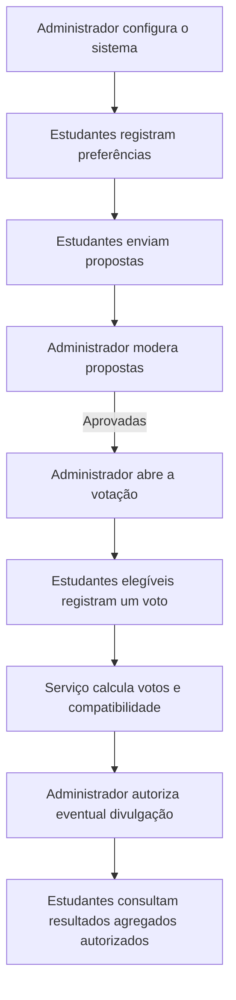

# ThreeShirt

ThreeShirt é um projeto escolar em desenvolvimento para organizar a escolha
da camiseta do terceirão. O backend reúne preferências dos estudantes,
propostas de design, moderação e regras de votação e apuração em um fluxo
persistido e verificável.

O projeto busca tornar a decisão coletiva mais estruturada: estudantes podem
registrar preferências e propostas, enquanto administradores controlam a
moderação e a votação. A compatibilidade entre preferências e propostas
complementa a apuração dos votos, sem substituir a escolha democrática.

> **Estado atual:** a jornada do estudante da Etapa 12 está integrada ao
> backend: login por código, sessão, logout, pesquisa, envio e acompanhamento
> de propostas, galeria aprovada, voto e consulta de resultados autorizados.
> O projeto permanece em desenvolvimento e não é um serviço de produção.

## Conteúdo

- [Funcionalidades e escopo](#funcionalidades-e-escopo)
- [Fluxo do sistema](#fluxo-do-sistema)
- [Regras e decisões técnicas](#regras-e-decisões-técnicas)
- [Arquitetura](#arquitetura)
- [Tecnologias](#tecnologias)
- [Executar localmente no Windows](#executar-localmente-no-windows)
- [Frontend (Etapa 12)](#frontend-etapa-12)
- [Testes e validação](#testes-e-validação)
- [Estrutura do repositório](#estrutura-do-repositório)
- [Processo de desenvolvimento](#processo-de-desenvolvimento)
- [Próximas etapas e limites](#próximas-etapas-e-limites)

## Funcionalidades e escopo

| Área | Estado |
| --- | --- |
| Login por código, sessão, logout e proteção da área estudante | Implementados no backend e integrados no frontend |
| Pesquisa individual de preferências | Consulta e gravação próprias disponíveis por API e formulário React; gravação depende da pesquisa aberta |
| Cadastro e acompanhamento de propostas | Envio por API e formulário; estudante acompanha somente propostas próprias |
| Moderação de propostas no Django Admin | Implementada |
| Armazenamento e entrega protegida de imagens | Implementados; a galeria lista somente propostas aprovadas |
| Abertura e encerramento manual da votação | Implementados no Django Admin |
| Voto único em proposta aprovada | Implementado no backend, com unicidade no banco e confirmação na interface |
| Apuração de votos, percentuais e empates | API e tela agregadas, liberadas após autorização e encerramento da votação |
| Média de compatibilidade com a pesquisa | API e tela agregadas; respostas individuais não são expostas |
| Autorização persistente para divulgação | Controlada pelo administrador; começa desativada |

O estudante pode editar suas próprias preferências enquanto a pesquisa estiver
aberta. Propostas enviadas seguem pendentes até moderação administrativa; não
há edição de propostas pelo estudante. Um voto só é aceito uma vez, durante a
votação aberta, para uma proposta aprovada. Os resultados só são retornados
depois do encerramento e da autorização administrativa.

## Fluxo do sistema



## Regras e decisões técnicas

### Solicitação de códigos de login

As solicitações são limitadas a três por conta e dez por origem em qualquer
janela móvel de 60 segundos. Os identificadores de conta e origem são
armazenados como HMAC, e os contadores são persistidos no banco para
sincronização entre processos. A origem usa `REMOTE_ADDR`, fornecido pelo
servidor WSGI; cabeçalhos como `X-Forwarded-For` não são considerados. Em uma
implantação atrás de proxy, o proxy e o servidor WSGI precisam estar
configurados para fornecer o endereço real do cliente de forma confiável.
Um novo código é persistido inicialmente como inativo e só é ativado, junto
com a invalidação dos anteriores, após a confirmação do envio. Se a ativação
falhar depois do envio, o novo código permanece inativo e o anterior continua
válido. Uma exceção do transporte não permite saber se o provedor aceitou o
e-mail; nesse caso nenhum código novo é ativado e o código anterior é mantido.

### Votação e apuração

- Cada estudante pode registrar no máximo um voto. `Vote.student` é uma
  relação `OneToOneField`, impondo unicidade também no banco.
- O serviço de voto exige usuário autenticado, ativo, com perfil de estudante,
  votação aberta e proposta aprovada.
- A apuração conta votos reais do banco e considera no ranking e no
  denominador somente votos associados a propostas atualmente aprovadas.
- Se uma proposta que recebeu votos deixar de estar aprovada, seus votos não
  são apagados: são reportados separadamente como excluídos da apuração
  corrente. Essa escolha conserva o histórico sem incluir proposta inelegível
  entre as vencedoras.
- Sem votos válidos, o resultado informa ausência de votos, não calcula
  percentuais e não declara vencedora. Empates de votos retornam todas as
  propostas com a maior contagem.

### Compatibilidade

- `calculate_compatibility()` compara cada resposta individual com cada
  proposta aprovada e retorna o escore e a quantidade de critérios
  comparáveis.
- A média geral considera respostas de contas atualmente ativas com perfil
  `STUDENT`; perfis administrativos, ausentes ou inativos não participam.
- A média geral é calculada somente sobre escores individuais válidos. Uma
  resposta insuficiente não é tratada como zero; sem avaliações válidas, o
  resultado informa dados insuficientes.
- Empates de compatibilidade são definidos após arredondamento para duas
  casas decimais com `ROUND_HALF_UP`, a mesma precisão de apresentação usada
  pelo cálculo individual. Todas as propostas equivalentes nessa precisão
  são retornadas.

### Autorização de divulgação

`ElectionSettings.results_release_authorized` persiste a decisão
administrativa, começa desativado e é controlado pelas permissões do Django
Admin já existentes. Calcular resultados não habilita divulgação. A API exige
estudante ativo, autorização administrativa e votação encerrada; sem essas
condições, os dados agregados não são retornados.

### Imagens, permissões e integridade

- Imagens de propostas são verificadas pelo conteúdo com Pillow, limitadas a
  5 MiB e aceitas nos formatos PNG, JPEG e WebP.
- Os arquivos ficam em armazenamento privado sem URL pública. A rota
  protegida permite a imagem de proposta pendente apenas ao administrador
  autorizado; imagens aprovadas podem ser vistas por estudantes autenticados
  e administradores autorizados. Propostas rejeitadas não são servidas.
- A migration `0004` migra imagens previamente armazenadas no diretório
  público para o armazenamento privado. Sua reversão é deliberadamente
  limitada para evitar recolocar imagens no armazenamento público.
- No SQLite, `transaction_mode="IMMEDIATE"` inicia transações com bloqueio de
  escrita antecipado. Operações de voto e de alteração da configuração têm
  repetição limitada para erros SQLite de contenção; a constraint de
  unicidade continua sendo a proteção final contra votos duplicados.
- A configuração atual é de desenvolvimento (`DEBUG=True`); use segredo,
  e-mail, hospedagem e configurações de segurança apropriados antes de
  qualquer implantação real.

## Arquitetura

- **`accounts`**: perfis e papéis de usuário, login por código temporário e
  site administrativo restrito a e-mails autorizados.
- **`election`**: preferências, propostas, votos e configuração singleton da
  eleição; serviços concentram validações, compatibilidade e apuração.
- **Django Admin**: interface administrativa existente para moderar propostas,
  controlar pesquisa/votação e autorizar a divulgação futura.
- **Armazenamento privado**: `PrivateProposalStorage` mantém imagens fora de
  URLs públicas; a view protegida valida e entrega somente arquivos
  permitidos.
- **Frontend**: `frontend/` contém a interface React, TypeScript e Vite, com
  login por código, contexto de sessão e telas de preferências, propostas,
  galeria/votação e resultados. O proxy de desenvolvimento encaminha `/api`
  e `/proposals` ao Django sem alterar os caminhos.
- **Testes**: `accounts/tests.py` e `election/tests.py` verificam regras de
  negócio, permissões, migrações de imagem e concorrência SQLite com conexões
  independentes.

## Tecnologias

Dependências listadas em `threeshirt/requirements.txt`:

| Tecnologia | Versão |
| --- | --- |
| Django | 6.1.2 |
| Pillow | 12.3.0 |
| python-dotenv | 1.2.4 |

Os testes desta revisão foram executados com Python 3.14.3 e SQLite 3.50.4.
Essas versões descrevem o ambiente local, não uma matriz de compatibilidade
para outros ambientes.

O frontend usa React, TypeScript e Vite. As versões e dependências exatas
ficam declaradas em `frontend/package.json` e travadas em
`frontend/package-lock.json`; é necessário Node.js 20.19+ (ou 22.12+).

## Executar localmente no Windows

Abra o PowerShell na raiz do repositório:

```powershell
Set-Location .\threeshirt
py -3.14 -m venv .venv
.\.venv\Scripts\Activate.ps1
python -m pip install -r .\requirements.txt
```

Crie `threeshirt\.env` localmente. Não compartilhe nem versione esse arquivo:

```dotenv
DJANGO_SECRET_KEY=use-uma-chave-aleatoria-local
THREESHIRT_ALLOWED_EMAILS=admin@exemplo.com
THREESHIRT_ADMIN_EMAILS=admin@exemplo.com
THREESHIRT_CSRF_TRUSTED_ORIGINS=http://127.0.0.1:5173
```

Cadastre a conta administrativa inicial com um e-mail incluído nas duas
variáveis:

```powershell
python -c "from django.core.management.utils import get_random_secret_key; print(get_random_secret_key())"
python manage.py migrate
python manage.py createsuperuser
python manage.py runserver
```

Use o valor gerado para `DJANGO_SECRET_KEY`. A aplicação só autentica e-mails
autorizados que correspondam a usuários já cadastrados. No ambiente local, o
backend usa SMTP por padrão; a entrega real depende da configuração de
`EMAIL_HOST`, `EMAIL_PORT`, `EMAIL_USE_TLS`, `EMAIL_HOST_USER`,
`EMAIL_HOST_PASSWORD` e `DEFAULT_FROM_EMAIL` no ambiente. Para desenvolvimento
sem envio externo, configure `EMAIL_BACKEND` como
`django.core.mail.backends.console.EmailBackend`; nesse modo, o código é
exibido na saída do servidor. O painel administrativo fica em
`http://127.0.0.1:8000/admin/`;
as rotas de autenticação são `POST /api/accounts/request-code/` e
`POST /api/accounts/verify-code/`. O frontend obtém um token CSRF por
`GET /api/accounts/csrf/`; a origem informada em
`THREESHIRT_CSRF_TRUSTED_ORIGINS` deve corresponder exatamente à origem do
navegador.

`POST /api/accounts/request-code/` responde com um estado estruturado:
`unauthorized`, `account_unavailable`, `send_failed`, `rate_limited`,
`invalid_email` ou `enter_code`. O frontend só mostra o campo do código
quando o backend confirma `enter_code`, após o mecanismo de e-mail aceitar
o envio. Os estados `unauthorized` e `account_unavailable` permitem
identificar a autorização e existência de conta; esta exposição é intencional
para atender ao fluxo de acesso solicitado e pode facilitar enumeração. As
respostas não incluem códigos, credenciais ou detalhes SMTP. `enter_code`
confirma aceitação pelo backend de e-mail, não entrega final na caixa postal.
A verificação do código continua sendo feita pelo backend.

### Frontend (Etapa 12)

Instale e execute o frontend em um segundo terminal, na raiz do repositório:

```powershell
npm --prefix .\frontend ci
npm --prefix .\frontend run dev
```

Abra o endereço indicado pelo Vite (por padrão,
`http://127.0.0.1:5173/`). O servidor de desenvolvimento encaminha, sem
reescrever, `/api/*` e `/proposals/*` ao Django em
`http://127.0.0.1:8000`. Execute o backend separadamente, na pasta
`threeshirt`, com `python manage.py runserver 127.0.0.1:8000`.

Verifique o frontend com:

```powershell
npm --prefix .\frontend run typecheck
npm --prefix .\frontend test
npm --prefix .\frontend run build
```

O login solicita um código e verifica-o por meio das views Django existentes.
Antes de cada POST, o cliente busca um token CSRF em
`/api/accounts/csrf/`, envia-o no cabeçalho `X-CSRFToken` e inclui cookies de
sessão. O proxy de desenvolvimento não contorna o `CsrfViewMiddleware`.
Configure `THREESHIRT_CSRF_TRUSTED_ORIGINS` para as origens exatas necessárias
em cada ambiente; não inclua a origem local do Vite em produção por padrão.
O login só informa sucesso quando a verificação real retorna HTTP 200.
`GET /api/accounts/session/` consulta a sessão atual: retorna HTTP 200
com `{"authenticated": false}` para visitantes; para usuários autenticados,
retorna `authenticated: true` e `user` com `id`, `email` e papel (`student` ou
`admin`) lido do perfil armazenado no backend. A consulta não altera a sessão
nem o perfil.

O endpoint `GET /api/election/student/dashboard/` fornece aos estudantes
ativos somente os estados da pesquisa, votação e divulgação de resultados,
além de indicar se o próprio estudante respondeu às preferências ou votou.
Ele não retorna respostas, votos ou resultados. `GET
/api/election/student/proposals/` lista para estudantes ativos somente as
propostas aprovadas, em ordem da mais recente para a mais antiga, com
desempate determinístico por identificador. A resposta contém os campos
visuais da proposta e aponta para a rota de imagem protegida, sem revelar
dados do autor ou caminho interno do arquivo.

`GET /api/election/student/preferences/` consulta somente as preferências do
estudante autenticado. `POST` no mesmo caminho cria ou atualiza a resposta
enquanto a pesquisa estiver aberta. `GET /api/election/student/submissions/`
retorna os estados e descrições das propostas do próprio estudante; `POST`
no mesmo caminho recebe os campos e a imagem multipart, sempre criando uma
proposta pendente. O estudante não pode editar propostas já enviadas.

`POST /api/election/student/vote/` recebe `{"proposal_id": <id>}` e delega ao
serviço de votação, que valida estudante ativo, votação aberta, proposta
aprovada e voto único. `GET /api/election/student/results/` fornece somente
contagens, percentuais, compatibilidade média e vencedoras; retorna HTTP 403
se a divulgação não foi autorizada e HTTP 409 enquanto a votação estiver
aberta. A API não retorna votos nem respostas individuais.

A rota `/proposals/<id>/image/` continua protegida no Django: imagens
pendentes são exclusivas de administradores autorizados, imagens aprovadas
exigem estudante autenticado ou administrador autorizado, e propostas
rejeitadas não são servidas.

> O comando `migrate` aplica as migrations pendentes no banco configurado.
> Antes de usá-lo em um banco com dados importantes, confira o plano e faça
> um backup validado.

## Testes e validação

Com o ambiente virtual ativado, na pasta `threeshirt`:

```powershell
python manage.py check
python manage.py makemigrations --check --dry-run
python manage.py test
```

Para o frontend, na raiz do repositório:

```powershell
npm --prefix .\frontend test
npm --prefix .\frontend run typecheck
npm --prefix .\frontend run build
git diff --check
```

Os testes Django cobrem permissões, validação, CSRF, armazenamento privado,
aprovação, voto único, concorrência e apuração. Os testes frontend cobrem
contratos da API, formulários, estados das telas, confirmação de voto,
resultados e expiração da sessão.

## Estrutura do repositório

```text
ThreeShirt/
├── README.md
├── frontend/
│   ├── package.json
│   ├── package-lock.json
│   ├── index.html
│   └── src/
└── threeshirt/
    ├── manage.py
    ├── requirements.txt
    ├── backend/
    │   ├── settings.py
    │   └── urls.py
    ├── accounts/
    │   ├── models.py
    │   ├── views.py
    │   ├── admin.py
    │   └── tests.py
    └── election/
        ├── models.py
        ├── services.py
        ├── concurrency.py
        ├── views.py
        ├── storage.py
        ├── validators.py
        ├── admin.py
        ├── tests.py
        └── migrations/
```

O banco SQLite e os diretórios de arquivos enviados são dados locais; não
devem ser tratados como parte do código-fonte.

## Processo de desenvolvimento

As etapas implementadas foram construídas progressivamente em torno dos
modelos e serviços Django existentes:

1. Autenticação e perfis estabelecem os papéis de estudante e administrador.
2. A pesquisa persiste preferências e fornece os dados para o cálculo
   individual de compatibilidade.
3. Propostas passam por validação e moderação administrativa; as imagens são
   armazenadas em área privada e servidas por uma rota protegida.
4. A votação controla abertura e encerramento, valida elegibilidade e impõe
   voto único também no banco. No SQLite, transações `IMMEDIATE` e repetição
   limitada lidam com contenção concorrente.
5. A apuração agrega votos, mantém visíveis os votos excluídos por status e
   calcula médias individuais sem converter dados insuficientes em zero.
6. A autorização administrativa de divulgação é persistente e separada do
   cálculo; a API e a tela exibem somente resultados agregados autorizados.

As decisões são cobertas por testes automatizados das aplicações `election`
e `accounts`. A migration `0005` adiciona a autorização com valor inicial
desativado; migrations locais devem ser verificadas antes de aplicação.

## Próximas etapas e limites

- **Etapa 11:** estrutura técnica inicial do frontend.
- **Etapa 12:** jornada do estudante integrada, incluindo login por código,
  sessão, logout, pesquisa, propostas, votação e resultados autorizados.
- **Limites restantes:** não há interface administrativa React; configuração,
  moderação e liberação de resultados permanecem no Django Admin. O projeto
  ainda exige configuração e revisão próprias antes de qualquer uso em
  produção.
- **Ainda não confirmado:** equipe, responsabilidades individuais,
  implantação e operação em produção. Por isso, este README não atribui
  créditos pessoais nem declara o sistema pronto para uso real.
